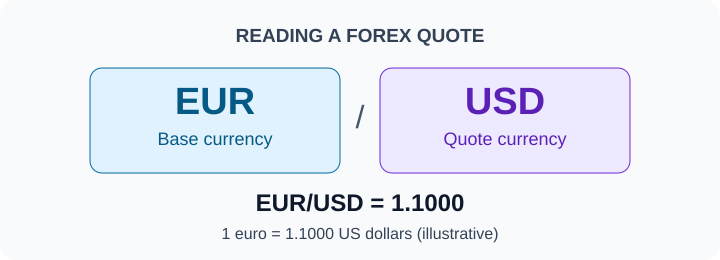
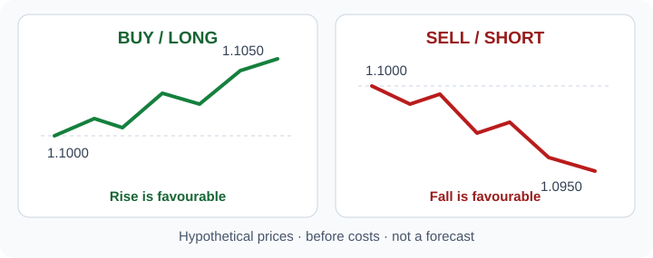

# Module 01 — Introduction to Forex Trading

**Study time:** approximately 30 minutes (including practice and review).  
**Goal:** understand what you are trading before learning how to trade.

[Back to course outline](README.md)

## 1. What is Forex?

Forex (foreign exchange, or FX) is the market for exchanging one currency for another.

Imagine visiting the United States from South Africa. You exchange rand (ZAR) for US dollars (USD). If the exchange rate changes, the same number of dollars may later cost more or fewer rand.

Retail Forex trading usually means taking a position on the price movement of a currency pair through a broker. Depending on the product, you may be trading a leveraged contract rather than physically exchanging or owning currencies. A correct prediction can generate a profit; an incorrect prediction can result in a loss.

## 2. How the Forex market works

Unlike a single stock exchange, much of Forex trading takes place through a network of dealers and financial institutions, known as an over-the-counter (OTC) market. Prices change as buyers and sellers respond to economic news, interest rates, expectations and other market conditions.

| Participant | Why they participate |
| --- | --- |
| Central banks | Manage monetary policy and currency reserves; may intervene in currency markets. |
| Commercial banks and dealers | Exchange currencies for clients and manage their own exposures. |
| Businesses | Pay foreign suppliers and manage exchange-rate risk. |
| Investment funds | Invest, hedge and speculate. |
| Retail traders | Speculate on currency price movements, usually through brokers. |

## 3. Currency pairs

Currencies are quoted in pairs. The first is the **base currency** and the second is the **quote currency**.

If EUR/USD is 1.1000, one euro is worth 1.1000 US dollars at that illustrative rate. If EUR/USD rises, the euro has strengthened relative to the dollar (or the dollar has weakened relative to the euro). The quote alone does not tell you which currency drove the change.

| Pair | Base | Quote |
| --- | --- | --- |
| EUR/USD | Euro | US dollar |
| GBP/USD | British pound | US dollar |
| USD/JPY | US dollar | Japanese yen |
| USD/ZAR | US dollar | South African rand |

For example, USD/ZAR at 18.00 means one US dollar costs 18 rand; a rise to 19.00 means the rand has weakened relative to the dollar.

### Major, minor and exotic pairs

| Category | Meaning | Examples |
| --- | --- | --- |
| Major | Widely traded pairs involving USD and another major currency. | EUR/USD, GBP/USD, USD/JPY |
| Minor (cross) | Commonly, pairs between major currencies without USD. | EUR/GBP, EUR/JPY, GBP/JPY |
| Exotic | Commonly, a major currency paired with an emerging-market or less-traded currency. | USD/ZAR, USD/TRY |

These classifications are conventions, not strict regulatory definitions. Major pairs often have tighter spreads than less liquid pairs, but spreads vary by broker, instrument and market conditions.

## 4. Buying and selling

| Action | Also called | Expected pair movement |
| --- | --- | --- |
| Buy | Long | Price rises |
| Sell | Short | Price falls |

A buy on EUR/USD expresses the view that EUR will strengthen relative to USD. A sell expresses the opposite view. You can take either direction on a compatible retail Forex contract without holding the physical base currency.

For a buy, a rise from 1.1000 to 1.1050 is favourable before trading costs. For a sell, a fall from 1.1000 to 1.0950 is favourable before costs. These examples show direction only, not cash profit. Position size and costs will determine the actual result in later modules.

## 5. Bid, ask and spread

Your broker normally displays two prices for an OTC Forex symbol:

| Price | Meaning | Example |
| --- | --- | --- |
| Bid | Price at which you can sell the base currency or close a long position. | 1.1000 |
| Ask | Price at which you can buy the base currency or close a short position. | 1.1002 |

The **spread** is the difference between ask and bid. A market buy normally enters at the ask and closes at the bid; a market sell normally enters at the bid and closes at the ask. Actual execution may differ from the displayed quotes.

If quotes remain unchanged, immediately opening and closing a position would normally result in a loss from the spread, before any other charges. This is especially important when scalping small price movements on M1. We will calculate spreads, pips and monetary results in Module 02.

## 6. Brokers and trading platforms

A broker provides access to tradable instruments, quotes and order execution. MetaTrader 5 (MT5) is a trading platform; it is not the broker itself.

Broker conditions determine available symbols, spreads, commissions, leverage, execution rules and account protections. Check the legal entity, authorisation relevant to the product and jurisdiction, fees and withdrawal terms before depositing funds. A broker's presence in MT5 is not proof of regulatory authorisation.

A **demo account** uses simulated funds to practise trading. It is appropriate for this course, but demo fills and trading conditions may differ from live execution.

## 7. Other instruments available on some MT5 brokers

| Market | Illustrative symbols | What the price represents |
| --- | --- | --- |
| Forex | EURUSD, USDZAR | Exchange rate between currencies |
| Commodities/metals | XAUUSD, XAGUSD | Gold or silver quoted against USD |
| Stock indices | US30, NAS100 | A basket of stocks or a contract tracking an index |
| Cryptocurrencies | BTCUSD, ETHUSD | Digital asset price or a related contract |
| Synthetic/volatility indices | Volatility 75 Index | A provider-defined synthetic price series, not necessarily an exchange-traded index |

Symbol names and availability vary by broker. A CFD tracks an underlying price without necessarily giving you ownership of that asset. Synthetic instruments may behave differently from real-world financial markets; their rules depend on the provider. Different products have different contract sizes, costs and trading hours. Do not assume Forex pip values or position sizes carry over to other instruments.

## 8. Practical exercise — read a quote, not a trading signal

Use the illustrative prices below; these are not live quotes.

| Symbol | Bid | Ask |
| --- | --- | --- |
| EURUSD | 1.1000 | 1.1002 |
| GBPUSD | 1.2500 | 1.2503 |
| USDZAR | 18.0000 | 18.0050 |

1. Identify the base and quote currency for each symbol.
2. Which displayed EURUSD price would a market buy normally use? Which would a sell use?
3. Imagine EURUSD rises to 1.1050: which trade direction would benefit before costs?
4. Imagine USDZAR rises from 18.00 to 19.00: has the rand strengthened or weakened relative to USD?
5. If MT5 is already installed, open Market Watch (Ctrl+M on desktop), find a Forex symbol and observe its bid and ask. Open its chart and observe how the quote changes. Do not place a trade yet. If MT5 is not installed, use the table; full setup is in Module 04.

### Knowledge check

Try answering before expanding the solutions.

1. What is the difference between Forex trading and exchanging physical currency?
2. What does GBP/USD at 1.2500 mean?
3. Which direction is favourable for a short position?
4. Why can a new position show a loss even if the market has barely moved?
5. Why should you not reuse the same lot size across Forex, gold and synthetic indices without checking contract specifications?

Answers and exercise solutions

**Exercise:** EUR/USD = EUR and USD; GBP/USD = GBP and USD; USD/ZAR = USD and ZAR. EURUSD buys normally use 1.1002 and sells 1.1000. A rise benefits a long position before costs. A rise in USD/ZAR means the rand weakens relative to the dollar.

**Knowledge check:**

1. Retail trading can involve a contract on currency price movements rather than delivery of physical currencies.
2. One British pound is worth 1.2500 US dollars at the illustrative rate.
3. A falling pair price, before trading costs.
4. The spread and possibly commissions create an initial trading cost.
5. Contract sizes, tick values, currency conversion and instrument rules may differ, so the same volume can carry very different monetary risk.

## Key takeaways

- Forex pairs express the value of one currency in another.
- Buy when expressing a bullish view; sell when expressing a bearish view. Neither is a trade signal on its own.
- Bid, ask and spread affect entry, exit and costs.
- MT5 is a platform; a broker supplies the instruments and execution conditions.
- Learn on demo first. Leverage magnifies gains and losses, and a stop loss does not guarantee an exact loss limit.

## References and further reading (optional)

- [BIS — The foreign exchange market](https://www.bis.org/publications/working-paper-1094-foreign-exchange-market): OTC market structure.
- [MetaTrader 5 — Market Watch](https://www.metatrader5.com/en/terminal/help/trading/market_watch): observing quotes.
- [MetaTrader 5 — Executing trades](https://www.metatrader5.com/en/terminal/help/trading/performing_deals): order execution and quotes.
- [CFTC — Eight things to know before trading Forex](https://www.cftc.gov/LearnAndProtect/AdvisoriesAndArticles/CustomerAdvisory_MustKnowForex.html): general retail Forex risks (US regulator; local regulatory rules differ).

**Next:** Module 02 — Essential Trading Terminology (pips, lots, costs, leverage, margin and practical calculations).
