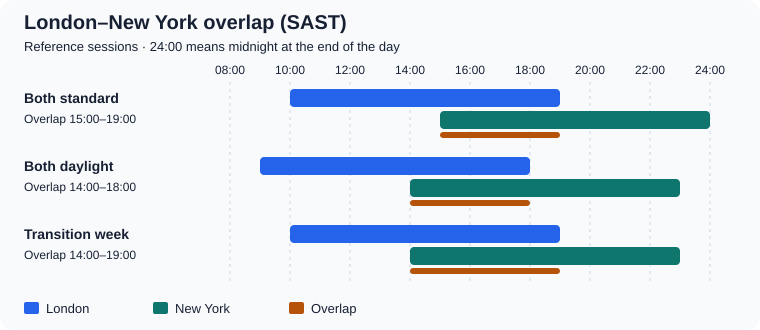

# Module 03 — Trading Sessions and Timeframes

**Study time:** approximately 30 minutes, including practice.  
**Goal:** understand when Forex markets are active and how to choose a chart timeframe for demo practice.

[Back to course outline](README.md) · [Previous: Module 02](02-trading-terminology.md)

## 1. When is the Forex market open?

Forex is a global, decentralised market. The main currency market normally trades almost continuously during the working week, from roughly Sunday 17:00 to Friday 17:00 New York time. For a South African trader, that usually means Sunday 23:00 to Friday 23:00 when New York observes daylight saving, or Monday 00:00 to Saturday 00:00 when it observes standard time.

Your broker may open later, close earlier or impose daily maintenance breaks, holiday schedules and instrument-specific trading hours. Check the symbol's trading sessions in MT5. Gold, stock indices, crypto and synthetic indices do not necessarily follow the Forex schedule; some synthetic instruments may trade on weekends.

## 2. The four major trading sessions

A session describes the usual active business hours of a financial centre, not an official opening bell for the entire Forex market.

South Africa uses SAST (UTC+2) throughout the year. Other countries may change their clocks.

The following table uses one common local-business-hours convention. Session guides can differ, especially for Sydney. Treat the times as reference windows, not guaranteed broker execution hours.

| Session | Local reference hours | SAST when centre uses standard time | SAST when centre uses daylight time |
| --- | --- | --- | --- |
| Sydney | 08:00–17:00 | 00:00–09:00 | 23:00 previous day–08:00 |
| Tokyo | 09:00–18:00 | 02:00–11:00 | No daylight saving |
| London | 08:00–17:00 | 10:00–19:00 | 09:00–18:00 |
| New York | 08:00–17:00 | 15:00–00:00 next day | 14:00–23:00 |

### Typical session characteristics

| Session | Common observations |
| --- | --- |
| Sydney | Early-week activity; liquidity may be thinner near the daily rollover. AUD and NZD-related pairs can respond to regional events. |
| Tokyo | Asian economic releases and JPY-related activity. |
| London | Broad participation in major Forex pairs; European economic news can increase activity. |
| New York | USD-related activity and US economic releases; overlap with London often brings substantial participation. |

These are tendencies, not entry signals or promises of volatility, spreads or profits.

## 3. Daylight saving and overlaps (SAST)

London and New York do not change clocks on identical dates. Sydney changes in the opposite season to the northern hemisphere. Tokyo and South Africa do not change clocks.

Use the centre's actual offset on the trading date instead of memorising a single annual schedule.

| Example weekday | Sydney | Tokyo | London | New York |
| --- | --- | --- | --- | --- |
| 19 January 2026 | 23:00 previous day–08:00 | 02:00–11:00 | 10:00–19:00 | 15:00–00:00 next day |
| 20 July 2026 | 00:00–09:00 | 02:00–11:00 | 09:00–18:00 | 14:00–23:00 |
| 16 March 2026 | 23:00 previous day–08:00 | 02:00–11:00 | 10:00–19:00 | 14:00–23:00 |

### Session overlaps

An overlap occurs when two reference sessions are active simultaneously.

| Overlap | Common SAST windows |
| --- | --- |
| Sydney–Tokyo | 02:00–08:00 or 02:00–09:00 |
| Tokyo–London | 10:00–11:00 or 09:00–11:00 |
| London–New York | 15:00–19:00 when both on standard time; 14:00–18:00 when both on daylight time; 14:00–19:00 during common transition weeks when London is on standard time and New York is on daylight time. |

The London–New York overlap often has substantial trading activity in major currency pairs. However, important news releases can cause spreads to widen and execution to worsen even when many traders are active.

**Quick reference:** [Forex session hours and date-aware converter](https://forexmechanics.com/trading-hours/trading-sessions/). Check the selected time zone and session convention. MT5 chart times are generally based on the broker's server, which may not equal SAST.

## 4. Liquidity and volatility

- **Liquidity:** how easily a position can be traded without substantially moving the price. Higher liquidity often helps spreads and execution, but does not guarantee either.
- **Volatility:** the size and speed of price fluctuations. A volatile market can move sharply in either direction.
- **Spread and slippage:** thin liquidity, news and rapid movement can make the price you receive worse than expected.

Higher volatility does not mean a better trade. More movement can create opportunities, but also larger or faster losses. If the spread or execution conditions make a planned demo setup unsuitable, observe rather than forcing an entry.

## 5. Trading timeframes

A timeframe is the period represented by one completed chart bar or candle. Changing it changes how you view the same instrument; it does not change the market itself.

| MT5 timeframe | One candle represents |
| --- | --- |
| M1 | 1 minute |
| M5 | 5 minutes |
| M15 | 15 minutes |
| M30 | 30 minutes |
| H1 | 1 hour |
| H4 | 4 hours |
| D1 | 1 trading day |
| W1 | 1 trading week |
| MN1 | 1 calendar month |

A completed M15 candle covers 15 minutes; its price information can be built from the underlying M1 observations in that interval. A still-forming candle can change until it closes. Bars may be absent when no quotes arrive, and day/week boundaries can depend on broker server time and trading sessions.

## 6. Trading styles

| Style | Typical holding time | Illustrative chart timeframes |
| --- | --- | --- |
| Scalping | Seconds to minutes | M1–M5 |
| Day trading | Minutes to hours; generally closed within the trading day | M5–H1 |
| Swing trading | Days to weeks | H4–D1 |
| Position trading | Weeks to months or longer | D1–W1 |

These categories are flexible. Chart timeframe is not the same as how long you hold a trade.

### Trading on M1

M1 provides frequent observations and potentially more entry opportunities. However, small price fluctuations, spreads, slippage and rapid decisions can have a greater impact relative to short-term targets. It can also encourage overtrading.

For our later demo strategy, we will use M15 to assess the broader direction and M1 or M5 to observe entries. This is an educational starting convention, not a proven strategy.

Before opening a demo trade, have a planned stop, position size and exit rule. Small, predefined risk can reduce emotional pressure. Automatic SL/TP attachment after execution still leaves an interval without protection and cannot guarantee an exact loss limit, particularly in fast markets. Our reusable MT5 EA will address protection in Module 12.

## 7. Practical exercise — observe, do not chase trades

If MT5 is available, use a demo account. Otherwise, use the reference tables until Module 04.

1. Convert today's or a chosen weekday's session windows to SAST using the table and date-aware converter.
2. Open the same Forex symbol on M1, M5 and M15. Compare the amount of visible price movement and how quickly the current candle changes.
3. During two different sessions, record the SAST time, broker chart time, symbol, spread and whether price is moving slowly or rapidly.
4. Note whether the spread widens around a scheduled release or rollover if you happen to observe one. No trade is required.

Use your observations to understand execution conditions, not to conclude that a session or timeframe guarantees profitable trades.

### Knowledge check

1. What time does London open in SAST when the UK is on daylight saving?
2. If London uses standard time and New York uses daylight time, what is their overlap in SAST using our reference convention?
3. Explain the difference between liquidity and volatility.
4. Does an M1 chart mean a position must close after one minute?
5. Why might the same lot size and stop placement have different execution outcomes during a news release?

Answers

1. 09:00 SAST.
2. 14:00–19:00 SAST.
3. Liquidity concerns ease of trading; volatility concerns price fluctuations.
4. No. A chart timeframe determines the bar duration, not the holding period.
5. Spreads can widen and slippage can increase as quotes and market conditions change; a protective order may fill at a different price.

## Key takeaways

- Use SAST for your routine and check daylight saving and broker hours.
- Session overlaps can increase activity, not guarantee profitability.
- Liquidity, volatility and execution quality are different concepts.
- M1 is fast; use a defined process and observe higher-timeframe context.
- Know your planned risk before entering a trade.

**Next:** [Module 04 — MetaTrader 5](04-metatrader-5.md).

## References (optional)

- [ForexMechanics — trading sessions and time-zone converter](https://forexmechanics.com/trading-hours/trading-sessions/): the local session convention used in this lesson.
- [Vantage — Forex session times in South Africa](https://www.vantagemarkets.com/en-za/academy/best-time-to-trade-forex-in-south-africa/): SAST and session characteristics; conventions may differ.
- [MetaTrader 5 — charts and timeframes](https://www.metatrader5.com/en/terminal/help/charts_analysis/charts).
- [MQL5 — chart timeframe reference](https://www.mql5.com/en/docs/constants/chartconstants/enum_timeframes).
