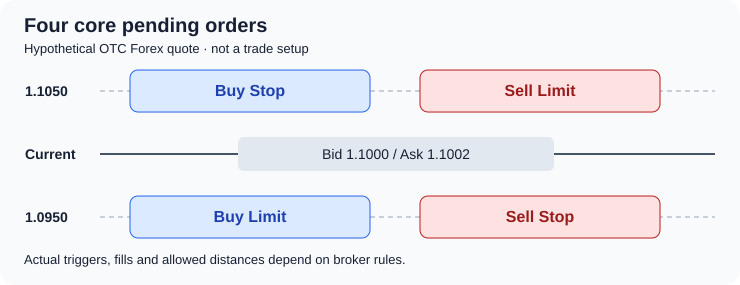
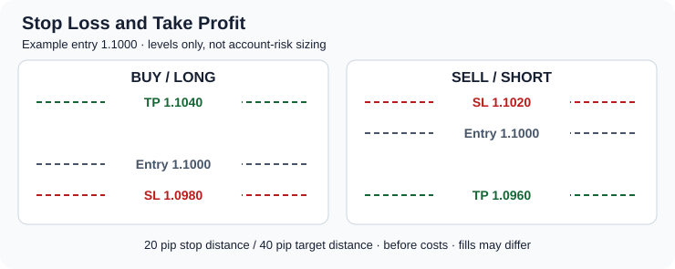

# Module 04 — MetaTrader 5

**Study time:** approximately 45–60 minutes, including hands-on practice.  
**Goal:** operate MT5 confidently on a demo account, with protective orders and a repeatable entry/exit workflow.

[Back to course outline](README.md) · [Previous: Module 03](03-trading-sessions.md)

All examples are hypothetical and intended for demo practice. This is a platform tutorial, not a trading signal. Menus can vary by operating system, terminal build, symbol and broker.

## 1. Install and connect a demo account

1. Install [MetaTrader 5 for desktop](https://www.metatrader5.com/en/download) from the official provider or your verified broker.
2. In MT5 desktop, select **File > Open an Account**, choose a broker server and choose the demo account option if available. Alternatively, use an existing demo login via **File > Login to Trade Account**.
3. Select the account type, deposit currency, simulated starting balance and leverage where the broker offers those choices. Use a realistic demo balance.
4. Verify the account is a demo account, the selected server is correct, and prices are updating. Never practise these exercises on a live account.

MT5 is a platform, not your broker. Account credentials and trading conditions belong to the broker. Never commit logins or passwords to this repository.

## 2. Learn the interface

| Area | Purpose | Windows shortcut |
| --- | --- | --- |
| Market Watch | Symbols, bid/ask, specifications | Ctrl+M |
| Navigator | Accounts, indicators and Expert Advisors | Ctrl+N |
| Toolbox | Trade, History, Experts and Journal | Ctrl+T |
| Chart | Price data and timeframe | Open via Market Watch |
| New Order | Order-entry dialog | F9 |

In Market Watch, right-click a symbol and open **Specification**. Review the contract size, tick size/value, volume limits and step, stops level, freeze level (where available), supported orders, execution mode and trading hours. Check the account currency. These parameters determine whether an order is valid and how much it can risk.

Open a chart from Market Watch, select candlesticks (Alt+2 on Windows) and switch among M1, M5 and M15. Chart prices and execution prices can differ: many OTC FX charts show bid prices by default. Enable the ask line in chart properties when useful. Chart times normally follow broker server time rather than SAST.

## 3. Orders, deals and positions

An **order** is an instruction to trade. A **deal** is a fill (an executed transaction). A **position** is the resulting open exposure; one order may have multiple deals. Do not assume sending an order means it was filled.

A market order requests immediate execution at available prices. A pending order specifies conditions for a later entry. Both are subject to execution rules; pending orders can expire, fail or remain unfilled.

### The four core pending orders

Assume a hypothetical bid of 1.1000 and ask of 1.1002. All example levels are far enough away for illustration only; actual broker limits must be checked.

| Order | Illustrative trigger price | Intended use |
| --- | --- | --- |
| Buy Limit | 1.0950 | Enter on a downward pullback, at the limit price or better |
| Sell Limit | 1.1050 | Enter on an upward pullback, at the limit price or better |
| Buy Stop | 1.1050 | Enter after an upward break; actual fill may differ |
| Sell Stop | 1.0950 | Enter after a downward break; actual fill may differ |

For ordinary OTC FX, buy triggers normally reference ask and sell triggers reference bid. Exchange instruments may have different trigger rules. Limit orders constrain the execution price but are not guaranteed to fill. Stop orders can slip after triggering.

MT5 also supports **Buy Stop Limit** and **Sell Stop Limit** where enabled. Reaching a stop trigger places a limit order: a Buy Stop Limit places a Buy Limit at the configured limit price, usually below the stop trigger; a Sell Stop Limit places a Sell Limit, usually above the trigger. Triggering does not guarantee the limit order will fill.

## 4. Stop Loss and Take Profit

A **Stop Loss (SL)** requests an exit when price moves adversely to a specified level. A **Take Profit (TP)** requests an exit when price reaches a favourable level.

| Direction | Stop Loss | Take Profit |
| --- | --- | --- |
| Buy | Below intended entry | Above intended entry |
| Sell | Above intended entry | Below intended entry |

For ordinary OTC Forex, protective levels of a long position are normally evaluated against bid; short-position levels against ask. The broker validates levels against the applicable current quote, tick size, minimum stop distance and other constraints, not just the entry price.

**Illustrative buy:** entry 1.1000, SL 1.0980, TP 1.1040. For a conventional EUR/USD pip, these distances are 20 and 40 pips respectively, a nominal 1:2 reward relative to risk before costs. A sell at 1.1000 could instead use SL 1.1020 and TP 1.0960. These numbers are not a recommendation or a guarantee of execution.

A stop distance alone does not determine the cash risk. Volume and contract specifications matter. Use the [pip value](../notebooks/01_pips_and_tick_values.ipynb) and [P/L](../notebooks/02_profit_and_loss.ipynb) notebooks for estimates; Module 08 covers sizing from a planned cash risk.

**Important for M1:** a 1% account-equity risk target is not a 1% price movement. The price levels must be calculated using volume, symbol properties and account currency. The default one-click panel does not calculate or automatically attach these percentage-based protections for a fresh position. We will build a separate EA in Module 12.

## 5. Place a protected demo market order

When the market is open and the demo connection is working:

1. Choose a Forex symbol and open **New Order (F9)**. Check that the correct symbol and demo account are selected.
2. Choose a valid small practice volume after inspecting the contract and estimating the planned loss. If even the minimum volume is too risky for the chosen stop distance, skip the exercise or adjust the simulated account size.
3. Select the available market/instant execution mode. Enter valid SL and TP price levels before sending where the broker supports this.
4. Review direction, volume, levels and current quote. Send the intended buy or sell request.
5. Check the execution result, then verify the actual open price, volume, SL and TP in Toolbox > Trade. Recalculate planned loss from the actual fill; a fill can alter the expected result.
6. If protection is absent or the order is rejected, do not assume it will be fixed automatically. Inspect the returned message, attempt valid protection promptly if exposed, or close the demo position if it cannot be protected. Confirm the result.

A successful request is not proof of protection. Some broker execution modes restrict initial SL/TP attachment. Even correctly accepted stops can execute at worse prices during gaps or fast markets.

Keep one-click trading disabled during beginner practice: it can submit orders without the usual confirmation dialog. It does not automatically apply account-equity-based SL/TP to new trades. Do not repeatedly send requests when the connection is uncertain; first check Trade and History to avoid duplicate positions.

## 6. Place and manage a pending order

Open F9, choose **Pending Order**, select the order type and enter the valid entry price, volume, SL/TP and expiration options supported by the broker. Verify the pending order appears in Trade. For stop-limit orders, specify both the stop trigger and the limit price.

Right-click the pending order to modify or delete it. A cancellation request may race with a fill, so confirm the order is gone and check whether a position was opened. Attached protection for a pending order becomes relevant to the resulting position after activation, subject to broker rules.

### Manage open positions

| Action | What to do |
| --- | --- |
| Modify SL/TP | Right-click position in Trade and choose Modify or Delete; enter levels, confirm and verify. |
| Close fully | Open the position's close dialog, confirm symbol and full remaining volume, then verify closure. |
| Close partially | Use the close dialog with a smaller permitted volume where supported; verify remaining exposure. |
| Review execution | Open History to check deals, entry/exit prices, commissions, swap and realised results. |

Do not use a new opposite order as a universal close command: on a hedging account it can open a separate opposite position.

### Trailing stop

A trailing stop adjusts the existing stop in the favourable direction after its configured activation condition is met. In MT5 desktop, right-click a position and choose **Trailing Stop**, then select the distance in points or a custom supported distance.

Example: 200 points on a five-decimal EUR/USD quote are 20 conventional pips. Check broker minimum distances. The terminal manages the trailing logic while running and connected; the last accepted server-side SL normally remains active if the terminal disconnects, but it will not continue trailing from that terminal. Verify an actual SL exists; simply enabling a trailing stop is not proof that protection is already attached. It does not guarantee profits or a particular exit price.

## 7. Hedging versus netting

| Account mode | Behaviour for the same symbol |
| --- | --- |
| Netting | One aggregate position; same-direction deals add exposure, opposite deals reduce, close or reverse it. |
| Hedging | Separate positions may coexist, including opposite directions, subject to broker rules. |

Example: starting flat, buy 0.10 lots and then sell 0.04 lots of the same symbol. In a netting account this normally leaves a 0.06-lot long position. In a hedging account, a separate new sell order may leave a 0.10-lot long and a 0.04-lot short position. Do not confuse net exposure with gross exposure or margin requirements.

On netting accounts, new deals can affect the aggregate position's SL/TP, so verify them after every change. On hedging accounts, manage protection and closure by position ticket. Opposite positions are not automatically risk-free.

## 8. The automatic risk manager — later implementation

Our planned Universal Risk Manager EA (Module 12) will support two manual-entry workflows:

- Detect manual trades and attempt to attach missing protection promptly after execution.
- Use explicit chart BUY/SELL controls to calculate protection and submit an order with SL/TP when supported.

The planned defaults are configurable 1% account-equity risk and 2% account-equity gross profit target. The EA is not implemented yet. Desktop MT5 or compatible hosting must be running for EA logic; ordinary accepted server-side stops are distinct from terminal-side trailing or automation. No EA can guarantee exact losses or broker acceptance.

See the [EA design](../expert-advisor/README.md) and [planned acceptance tests](../expert-advisor/TESTING.md).

## 9. Practical exercise and knowledge check

Use a demo account only. If the Forex market is closed, inspect the interface and specifications first, then perform order exercises during the next available session.

1. Open a chart, inspect symbol specifications and identify bid/ask.
2. Calculate an illustrative protected trade using the earlier notebooks, then place one small demo market order with SL and TP where supported. Verify its fill and protection.
3. Modify the SL or TP using valid levels, without increasing the original planned loss. Close the demo position and inspect History.
4. Place a demo pending order with protection, then cancel it if unfilled; if it fills, manage and close the position. Verify both orders and positions.
5. Identify your account's hedging/netting mode and explain how an opposite order would behave.

Answer these questions before opening the solutions:

1. What is the difference between a Buy Limit and a Buy Stop?
2. Where should SL and TP normally sit for a new short position?
3. Does pressing Buy on the standard one-click panel automatically attach a stop loss of 1% of account equity?
4. What happens to terminal-managed trailing logic if the terminal stops running?
5. What normally happens to a 0.10-lot netting long when a 0.04-lot sell is filled?

Solutions

1. Buy Limit requests entry at a lower price or better; Buy Stop triggers above the current ask in ordinary OTC FX and may fill at a different price.
2. SL above entry and TP below entry, also satisfying the broker's current-quote and stop-distance constraints.
3. No. Calculate and verify protection separately; the planned EA is a later implementation.
4. It stops adjusting from that terminal. Any previously accepted server-side SL normally remains in force.
5. The net position normally becomes a 0.06-lot long.

## Key takeaways

- Practise on a demo account; verify actual fills, positions and protection.
- Market, limit, stop and stop-limit orders have different execution behaviour.
- Always distinguish price-based stops from account-equity risk.
- One-click trading and terminal-side trailing have limitations.
- Account mode determines how positions are combined or separated.

**Next:** Module 05 — Technical Analysis.

## Official platform references

- [Opening an account](https://www.metatrader5.com/en/terminal/help/startworking/acc_open)
- [Getting started and platform interface](https://www.metatrader5.com/en/terminal/help/startworking)
- [Market Watch and symbol specifications](https://www.metatrader5.com/en/terminal/help/trading/market_watch)
- [Order types, protective orders and account modes](https://www.metatrader5.com/en/terminal/help/trading/general_concept)
- [Executing trades and trailing stops](https://www.metatrader5.com/en/terminal/help/trading/performing_deals)
- [One-click trading](https://www.metatrader5.com/en/terminal/help/trading/one_click_trading)
