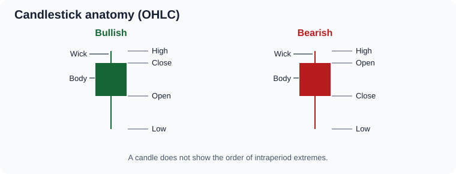
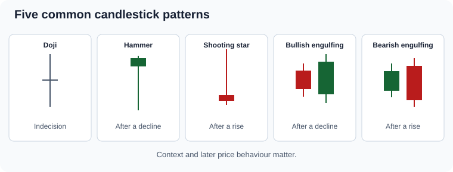
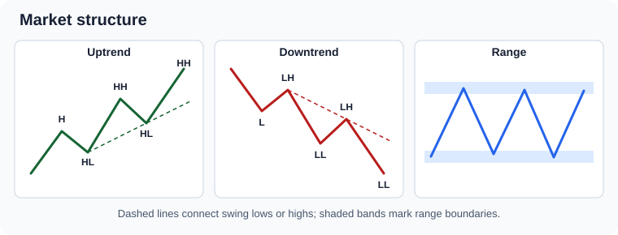
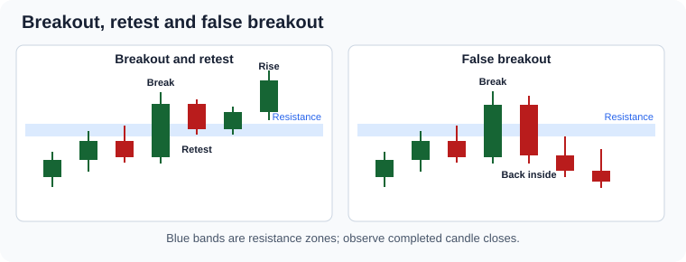

# Module 05 — Technical Analysis

**Study time:** approximately 45–60 minutes, including chart practice.  
**Goal:** read price action, identify market structure and mark price areas without treating patterns as guaranteed signals.

[Back to course outline](README.md) · [Previous: Module 04](04-metatrader-5.md)

All diagrams are original schematic examples, not historical or live prices. Practise on demo charts. Technical analysis interprets past price behaviour; it cannot reliably predict every future move.

## 1. Candlestick anatomy (OHLC)

Each completed candlestick summarises one chart interval.

| Part | Meaning |
| --- | --- |
| Open (O) | First price in the interval |
| High (H) | Highest price in the interval |
| Low (L) | Lowest price in the interval |
| Close (C) | Last price in the interval |
| Body | Distance between open and close |
| Upper/lower wick | Price extremes beyond the body |

A bullish candle closes above its open; a bearish candle closes below its open. Colour is configurable in MT5. A candle does not reveal the exact order in which its high and low occurred. A still-forming candle can change until it closes.

Example: O = 1.1000, H = 1.1030, L = 1.0990, C = 1.1020. This is a bullish candle with a 20-pip body, 10-pip upper wick and 10-pip lower wick for conventional EUR/USD pips.

## 2. Essential candlestick patterns

| Pattern | Appearance | Possible interpretation in context |
| --- | --- | --- |
| Doji | Open and close equal or nearly equal | Indecision; no direction guaranteed |
| Hammer | Small body near top, long lower wick, short upper wick | Possible bullish reversal after a decline |
| Shooting star | Small body near bottom, long upper wick, short lower wick | Possible bearish reversal after a rise |
| Bullish engulfing | Bullish body covers preceding bearish body | Possible shift towards buyers after a decline |
| Bearish engulfing | Bearish body covers preceding bullish body | Possible shift towards sellers after a rise |

A hammer-like shape after a rise is often called a hanging man; a shooting-star-like shape after a decline is often called an inverted hammer. Engulfing concerns real bodies, not necessarily the full wick-to-wick range. A gap is not required in our simplified Forex body-engulfing convention. Patterns can fail; wait for completed candles before classifying them.

## 3. Market structure and trends

A swing high is a local peak; a swing low is a local trough. Our practice convention: a swing high must be strictly above the highs of the two completed bars on either side, or a swing low strictly below the lows of the two completed bars on either side. The swing is only confirmed after the second following bar closes. Equal highs/lows are not confirmed by this strict rule.

| Abbreviation | Meaning |
| --- | --- |
| HH | Higher high: above previous swing high |
| HL | Higher low: above previous swing low |
| LH | Lower high: below previous swing high |
| LL | Lower low: below previous swing low |

- **Uptrend:** successive higher highs and higher lows.
- **Downtrend:** successive lower highs and lower lows.
- **Range:** price oscillates between broadly horizontal boundaries without a clear directional sequence.
- **Unclear structure:** mixed swings or insufficient confirmed swings; direction can remain undecided.

An impulse moves in the prevailing direction; a pullback temporarily moves against it. A pullback can become a reversal. Breaking the last confirmed higher low invalidates that simple bullish structure, but does not automatically establish a downtrend. Compare confirmed swings on the same timeframe. The schematic connects abstract swings, not individual candles.

## 4. Support, resistance and trendlines

Support is an area below or near price where declines previously stalled or reversed. Resistance is an area above or near price where advances previously stalled or reversed. Mark zones around repeated reactions rather than expecting exact prices to hold. These are observations, not barriers.

A trendline connects meaningful swing lows in an uptrend or swing highs in a downtrend. Two points define the line; further reactions may help assess its usefulness. Do not force a line through unrelated swings.

On MT5 desktop, use **Insert > Objects > Lines** for horizontal lines and trendlines (menu labels may vary). Mark zones with two horizontal lines or a rectangle. Record levels before the next candle forms rather than moving them to fit later price action.

## 5. Breakouts, retests and false breakouts

For our demo observation convention:

- **Breakout:** a completed candle closes beyond the marked support or resistance zone. A wick alone is insufficient.
- **Retest:** price returns towards the broken zone after a breakout. Old resistance may act as support or old support as resistance, but need not.
- **False breakout:** price closes beyond a zone and subsequently closes back in or through the zone into the previous range. A wick beyond the zone with a close inside is a rejected probe, not a confirmed breakout under our convention.
- **Continuation:** price resumes its previous direction after a pullback or consolidation. A retest does not guarantee continuation.

There is no universal number of bars proving a breakout will hold. Define confirmation and invalidation rules before observing the outcome.

## 6. Multiple-timeframe analysis

| Timeframe | Role in our later demo practice |
| --- | --- |
| M15 | Classify broader structure and mark important zones |
| M5 | Inspect local swings and pullbacks |
| M1 | Observe finer price movement and timing |

An M1 downtrend can be a pullback within an M15 uptrend. An M1 bullish candle does not establish an M15 reversal. Use the last completed candle on each timeframe; the current M15 candle can change while several M1 candles close. More timeframes are not necessarily better.

## 7. Practical chart-reading routine

Use an MT5 demo or historical chart, without placing an order for this exercise.

1. Open M15, identify confirmed swings and classify the structure as uptrend, downtrend, range or unclear.
2. Mark support and resistance zones and, where meaningful, one trendline.
3. Switch to M5 or M1 and identify the latest completed candles and their patterns.
4. Find a historical breakout, retest or rejected probe. Record what would have been observable at each completed candle, not just the eventual outcome.
5. Save an annotated screenshot with symbol, timeframe, date, marked zones and explanation. Repeat for a trending and a ranging example.

On M1, spread and slippage can be large relative to small price moves. A chart pattern alone says nothing about suitable volume, cash risk or expected net profit. Module 08 covers these calculations; Module 10 defines our demo strategy. Do not place a trade simply because you recognise a pattern.

### Knowledge check

1. O = 1.1000, H = 1.1040, L = 1.0990, C = 1.1020. Is the candle bullish or bearish, and how many conventional EUR/USD pips is its body?
2. Successive confirmed swing highs and lows rise. What structure is this?
3. Does a long lower wick alone prove a bullish reversal?
4. Resistance is 1.1050–1.1055. A candle reaches 1.1060 but closes at 1.1052. Is this a confirmed breakout under our convention?
5. Can M1 be falling while M15 retains an uptrend?

Solutions

1. Bullish; 20 pips.
2. Uptrend (HH and HL).
3. No. Context and subsequent behaviour matter.
4. No. The candle closes inside the zone: a rejected probe.
5. Yes. The lower-timeframe decline can be a pullback within the higher-timeframe uptrend.

## Key takeaways

- Read completed candles using OHLC, not colour alone.
- Distinguish confirmed trends, ranges and uncertainty.
- Support and resistance zones can fail.
- Breakouts can fail even after a candle closes beyond a zone.
- Separate chart observations from trading decisions.

**Next:** Module 06 — Technical Indicators.

## References (optional)

- [MT5 — View and configure charts](https://www.metatrader5.com/en/terminal/help/charts_analysis/charts)
- [MT5 — Analytical lines](https://www.metatrader5.com/en/terminal/help/objects/lines)
- [IG South Africa — Japanese candlestick guide](https://www.ig.com/za/trading-strategies/japanese-candlestick-trading-guide-200615)
- [Fidelity — Support and resistance](https://www.fidelity.com/learning-center/trading-investing/technical-analysis/support-and-)

External resources may use different pattern and confirmation conventions. No profitability claim is made.
